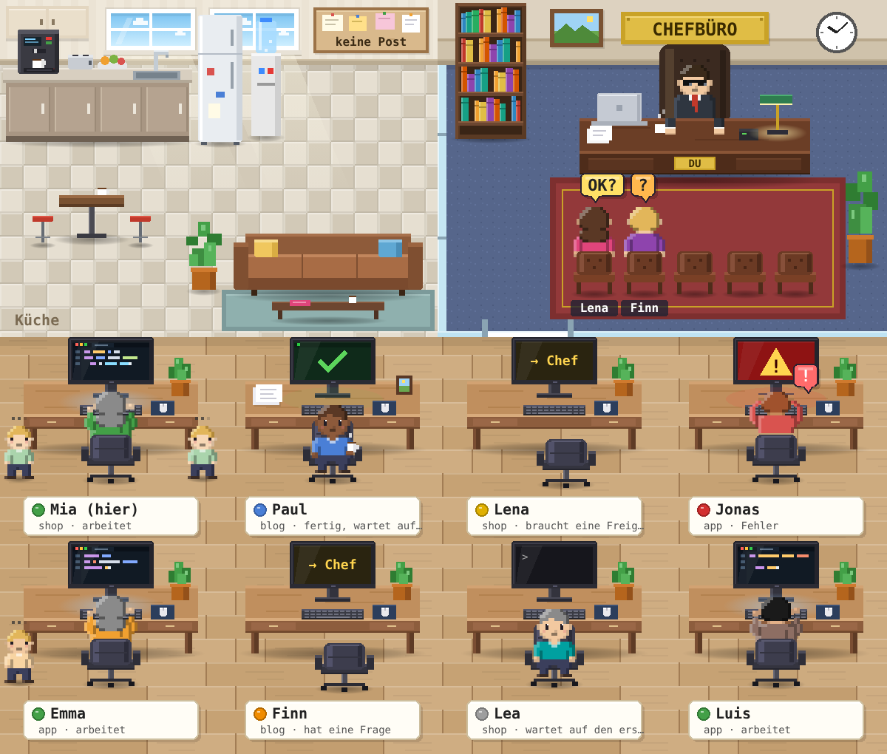

# Büro – deine Claude Code Sessions als Pixel-Art-Büro


Jede Claude-Code-Session ist ein Mitarbeiter an einem Schreibtisch. Wer auf
dich wartet, steht im **Chefbüro**. Die Sessions können sich außerdem
gegenseitig kurze Nachrichten schicken.

## Am einfachsten: die Büro-Seite

**[Claude-Büro öffnen](https://claude.ai/artifact/94pH1R4YMfQgxPUeghXbiK)**. Die Seite läuft in der Desktop-App, im
Browser und auf dem iPhone. Sie liest deine Cloud-Sessions live über den
Connector „Claude Code Remote“ und fragt beim ersten Öffnen einmal nach deiner
Erlaubnis. Ein Klick auf eine Figur zeigt die Details, dort kannst du der
Session auch eine Nachricht schicken.

Die Seite wird aus `seite/vorlage.html` und dem Zeichen-Code der Mod gebaut:
`node scripts/build-office-page.mjs`.

## Als Mod in Cloud-Sessions (Fenster in der Session)

Die Desktop-App zeigt Mod-Fenster in Cloud-Sessions derzeit nicht an
(„no surface is attached“). Die Werkzeuge `kollegen` und `nachricht` und das
Nachrichtenlimit wirken dort trotzdem.

**Einmal einrichten:**

1. Öffne irgendeine Cloud-Session und klicke in der Titelleiste auf das Umgebungsmenü, dann auf **Bearbeiten**.
2. Kopiere den kompletten Inhalt von [`buero-cloud-setup.sh`](../../../buero-cloud-setup.sh) in das Feld **Setup-Skript**. Steht dort schon etwas, häng ihn unten an. Dann speichern.
3. Starte eine **neue** Session. Ab jetzt hat jede neue Cloud-Session dieser Umgebung die Mod. Bereits laufende Sessions bekommen sie erst, wenn ihr Container neu aufgebaut wird.

Das Setup-Skript schreibt die Mod nach `~/.claude/skills/buero`. Von dort lädt
Claude Code sie in jeder Session, egal auf welchem Repo.

**Benutzen:** Tippe in einer Session `/buero`. Das Büro zeigt deine
Cloud-Sessions, die gerade arbeiten oder auf dich warten, und alle, die am
letzten Tag aktiv waren. Es aktualisiert sich alle 10 Sekunden.

- Wartet eine Session auf dich, steht sie im Chefbüro. Oben im Fenster steht, was sie braucht.
- Ein Klick auf einen Mitarbeiter zeigt Auftrag, Repo, Branch, letzte Zusammenfassung, Kontext und Kosten. Dort findest du außerdem den Link **Session öffnen** und ein Feld für eine Nachricht. Die iPhone-App zeigt noch keine Eingabefelder, der Link funktioniert dort aber.
- Eine Nachricht aus dem Büro kommt bei der Session als **Nachricht einer anderen Session** an, nicht als deine eigene Eingabe. Für einfache Antworten („Ja, mach Variante B“) reicht das. Freigaben, Moduswechsel oder Heikles erledigst du in der Session selbst.

**Nach Änderungen an der Mod:** Führe `scripts/make-cloud-setup.sh` aus und füge
das neue `buero-cloud-setup.sh` wieder ins Setup-Skript ein.

## Auf dem PC (lokale Sessions)

Hier liest das Büro die Sessions auf deinem Rechner, inklusive ihrer Agents
als Praktikanten und Freigabe-Anfragen.



Das Repository ist privat. Dein PC muss deshalb bei GitHub angemeldet sein,
z. B. über Git für Windows.

- **Desktop-App:** Klicke auf **+** neben dem Eingabefeld, dann auf **Plugins** und **Add marketplace**. Gib `leesyashin/Else-Live-` ein und klicke bei **buero** auf **Add plugin**.
- **Terminal:** `/plugin install buero --marketplace leesyashin/Else-Live-`

## Was die Figuren bedeuten

| Im Büro | Cloud | PC |
| --- | --- | --- |
| tippt, Code läuft über den Bildschirm | arbeitet | arbeitet |
| mit Kaffee zu dir umgedreht, grüner Haken | fertig oder bereit zur Durchsicht | fertig, wartet auf deinen nächsten Auftrag |
| steht im Chefbüro mit **?** | wartet auf dich | hat eine Frage |
| steht im Chefbüro mit **OK?** | – | braucht eine Freigabe |
| schläft am Tisch (Zzz) | arbeitet, aber seit 5 Min. nichts Neues | 5 Min. keine Aktivität während eines Auftrags |
| roter Bildschirm, **!** | fehlgeschlagen | Fehler beim Modell-Aufruf |

In der Desktop-App zeigt ein Tooltip über jeder Figur die Details.

## Absprache zwischen den Sessions

Jede Session mit der Mod bekommt zwei Werkzeuge: `kollegen` zeigt, wer gerade
woran arbeitet, und `nachricht` schickt einem Kollegen eine kurze Nachricht.
Die Sessions sind angewiesen, das nur zu nutzen, wenn es echte Arbeit spart,
und höchstens **5 Nachrichten pro Stunde** zu schicken. Das Limit gilt auch für
das eingebaute `send_message` der Cloud und für SendMessage an andere Sessions.
Nachrichten innerhalb des eigenen Teams einer Session zählen nicht.

## Einstellungen

Standardmäßig gelten **5 Nachrichten pro Stunde** und **„hängt“ nach 5 Minuten**.
Auf dem PC kannst du beides unter `/config` ändern.

## Was du wissen solltest

- In der Cloud siehst du keine Agents fremder Sessions, nur die der Session, in der das Büro offen ist.
- Auf dem PC schreibt jede Session ihren Status nach `~/.claude/buero/sessions/<session-id>.json`. Darin stehen Projektname, Ordner und die ersten 300 Zeichen deines letzten Auftrags. Die Dateien bleiben auf deinem Rechner.
- Die Mod nutzt die neue Mod-Schnittstelle von Claude Code. Gebaut und getestet wurde sie mit Version 2.1.302.

## Entwickeln

```
claude plugin validate .claude/skills/buero
claude plugin test .claude/skills/buero
scripts/make-cloud-setup.sh
```
