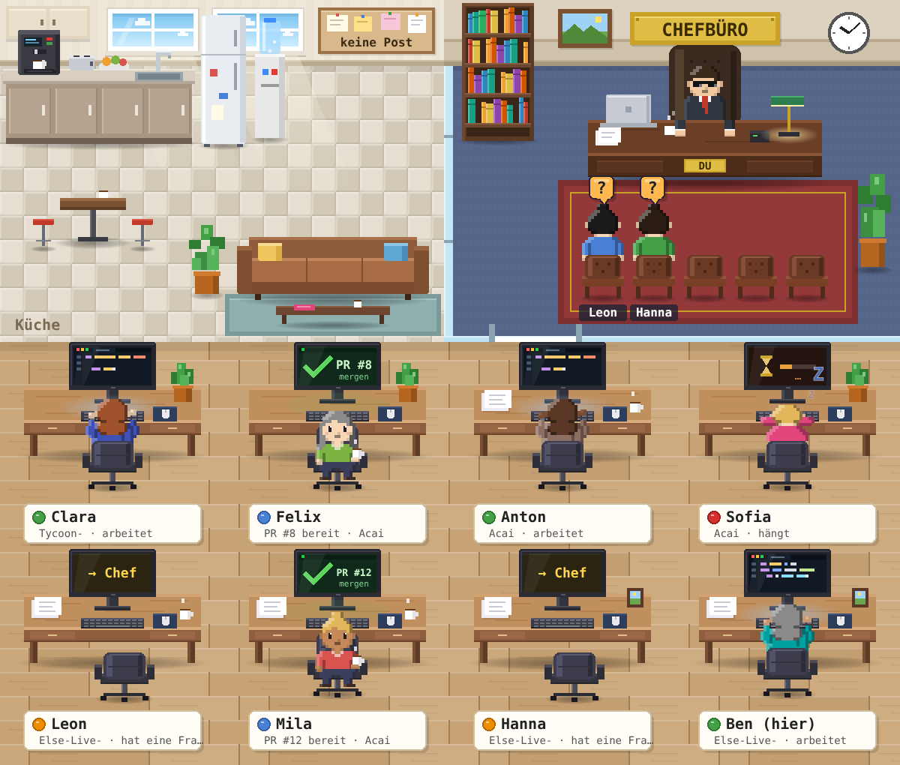

# Büro – deine Claude Code Sessions als Pixel-Art-Büro



Jede Claude-Code-Session ist ein Mitarbeiter an einem Schreibtisch. Wer auf dich wartet, sitzt im **Chefbüro** vor deinem Tisch. Neben dir sitzt der **Chef vom Dienst**: eine dauerhafte Session, die das Büro aktuell hält, deine Kommandos sofort annimmt, Aufträge anlegt, Mitarbeiter holt, verteilt und überwacht. Jede Session kann delegieren, abgeben, Inhalte ablegen und mit anderen zusammen denken. Der Plan dahinter: [`docs/PLAN.md`](../../../docs/PLAN.md).

## In fünf Minuten eingerichtet

1. **Setup-Skript in die Umgebung.** Öffne im Browser (claude.ai/code) irgendeine Cloud-Session, klicke in der Titelleiste auf das Umgebungsmenü, dann **Bearbeiten**, und füge den kompletten Inhalt von [`buero-cloud-setup.sh`](../../../buero-cloud-setup.sh) in das Feld **Setup-Skript** ein (steht dort schon ein Büro-Teil, ersetz ihn). Speichern. Die Cloud führt das Skript beim ersten Start nach der Änderung einmal aus, nimmt das Ergebnis als Abbild und startet jede weitere **neue** Session dieser Umgebung daraus ([Environment caching](https://code.claude.com/docs/en/cloud-environments#environment-caching)). Beim Bau des Abbilds hat das Skript keinen Zugang zu GitHub, darum zählt die eingebettete Kopie; der GitHub-Abruf im Skript bleibt ein Versuch für den Fall, dass die Cloud das einmal erlaubt. Laufende Sessions behalten ihre Version.
2. **Chef vom Dienst starten.** Sag einer Session mit der Mod: „Starte den Chef vom Dienst nach docs/cvd-dienstanweisung.md.“ Sie startet die Session im Repo Else-Live- mit dem Tag `buero:rolle=cvd` und richtet den Wecker ein. Oder du startest sie selbst mit dem Prompt aus [`docs/cvd-dienstanweisung.md`](../../../docs/cvd-dienstanweisung.md).
3. **Büro-Seite öffnen:** **[Claude-Büro](https://claude.ai/artifact/94pH1R4YMfQgxPUeghXbiK)**, auf dem iPhone, im Browser, in der App. Erstes Kommando in die Leiste oben: „Hol jemanden für … im Repo …“.

## Die Seite

Die Seite hat eine Navigation (am Rand, auf dem Handy als Leiste unten) mit den Bereichen Büro, Aufträge, Schwarzes Brett, Besprechungen, Ablage, Regeln und Mitarbeiter; ein Bereich zur Zeit, die Zähler in der Navigation sagen, wo etwas wartet. Alles aktualisiert sich von selbst (Live-Daten aus der Datenbank der Seite). Farben sind die iOS-Systemfarben: Blau für alles, was du anfassen oder beantworten sollst, Grün arbeitet, Türkis fertig, Rot hängt.

| Bereich | Was du dort tust |
| --- | --- |
| **Büro** (Startseite) | Kommando, die Zahlen, die Bühne, daneben „Für dich“ und das Session-Detail. |
| **Kommandoleiste** | Sag dem Chef vom Dienst, was er tun soll. **Senden** legt es in den Briefkasten (in höchstens 15 Sekunden bei ihm). **Sofort** schickt zusätzlich einen Kommentar an Claude, der ihn auch aus dem Schlaf weckt. Darunter stehen deine Kommandos mit Zustand (neu, angenommen, in Arbeit, erledigt, abgelehnt, braucht dich) und seiner Antwort. |
| **Für dich** | Wer auf dich wartet, mit der Frage im Wortlaut und einem Antwortfeld. Freigabe-Karten beantwortest du in der Session selbst („Session öffnen“). |
| **Bühne** | Das Pixel-Büro. Der Chef vom Dienst sitzt mit Headset an seinem eigenen Schreibtisch im Chefbüro („in Bereitschaft“), Teams stehen zusammen, Prüfer tragen eine Lupe. Klick auf eine Figur öffnet ihr Detail. |
| **Aufgabenbrett** | Aufträge in den Spalten offen, vergeben, in Arbeit, Review, blockiert, fertig. Anlegen, „Session holen“ (der Chef vom Dienst holt sie), öffnen: Text, Abnahme, Besitzer, PR, Verlauf, Übergabe. |
| **Besprechungsraum** | Offene Besprechungen mit den Beiträgen der Sessions; „Zusammenfassen“ (Chef vom Dienst) und „Entscheiden“ (du). |
| **Ablage** | Notizen, Links und Dateien, die Sessions und du geteilt haben, mit Vorschau, nach Repo und Tag. |
| **Schwarzes Brett** | Das Logbuch der letzten 7 Tage: wer arbeitet, pusht, fertig ist, welche PRs auf- und zugehen, Aufträge, Übergaben, Kommandos. |
| **Session-Detail** | Rolle, Team, Auftrag, Stand, Kontext und Kosten, PR, Mod-Version (rot, wenn veraltet). Knöpfe: Nachricht, Sofort, Pausieren, Weiter, Archivieren, Session öffnen. Antworten der Session auf deine Nachrichten stehen darunter. |
| **Regeln** | Pro Repo: Merge nie, bei grüner CI oder bei grün plus Prüfer; Modelle je Rolle; Branch-Schema; Prüfbefehle; Archivieren nach Merge; höchstens parallele Sessions; Freigaben in Worten. |

Ist kein Chef vom Dienst und keine andere Session mit der Mod wach, sagt die Seite das: Post und Kommandos warten dann im Briefkasten, der Sofort-Knopf weckt den Chef vom Dienst.

## Rollen

| Rolle | Wer | Erkennung |
| --- | --- | --- |
| Chef | du | die Seite, Kommentare, jede Session |
| Chef vom Dienst | eine dauerhafte Cloud-Session im Repo Else-Live- | Tag `buero:rolle=cvd` |
| Mitarbeiter | jede Arbeits-Session | Standard; aus einem Auftrag gestartet mit Tag `buero:auftrag=<id>` |
| Praktikant | Subagents einer Session | bleibt in der Session |
| Prüfer | Session mit Prüfauftrag | Tag `buero:rolle=pruefer` |

„Bote“ ist eine Pflicht, keine Rolle: Normalerweise erfüllt sie der Chef vom Dienst (er nimmt die Lease immer, wenn er wach ist). Fällt er aus, übernimmt nach drei Minuten die nächste wache Session, bis er zurück ist.

## Kanäle und wie schnell sie sind

| Kanal | Latenz | Mechanik |
| --- | --- | --- |
| Briefkasten (Seite an Session) | höchstens 15 s, über den Boten 35 s | `post/<id>`; die Mod der Session holt ab, auch mitten im Auftrag |
| Kommando (Seite an Chef vom Dienst) | höchstens 15 s | `kommandos/<id>`; strukturierte Kommandos (Pausieren, Weiter, Archivieren, dringende Nachricht) führt die Mod selbst aus, freie gehen an das Modell |
| Sofort (Seite an Chef vom Dienst) | sofort, aus dem Schlaf etwa eine Minute | Kommentar „an Claude senden“; der Chef vom Dienst hält die Watch auf die Seite |
| Session an Session | sofort | `send_message` der Cloud plus Brief auf der Seite für den laufenden Auftrag |
| Neue Session | etwa eine Minute | `create_session` mit Prompt aus dem Auftrag, Tags, Branch, Modell |
| GitHub an Session | Sekunden | `subscribe_pr_activity` in der Kind-Session |
| Zeit | Minutentakt, Wecker stündlich | `send_later`, geplante Aufgaben |
| An dich | Sekunden | Push vom Chef vom Dienst, wenn jemand auf dich wartet, ein Auftrag fertig ist oder er dich braucht |

## Was eine Session kann

Jede Session mit der Mod bekommt diese Werkzeuge (alle `mcp__buero__…`):

| Werkzeug | Zweck |
| --- | --- |
| `kollegen` | wer gerade woran arbeitet: Name, Session-ID, Rolle, Team, Projekt, Auftrag, Stand, Mod-Version; die letzten Ereignisse im Büro |
| `nachricht` | kurze Nachricht an einen Kollegen, höchstens 5 pro Stunde (einstellbar) |
| `auftrag` | anlegen, zeigen, annehmen, aendern, review, abschliessen, blockieren, abbrechen |
| `kollegen_holen` | neue Session für einen Auftrag: Prompt aus Auftrag und Repo-Regeln, Tags, Branch, Modell; die neue Session erscheint im Team |
| `abgeben` | den eigenen Auftrag mit Übergabe (Stand, Branch, offene Punkte, Fallen, nächster Schritt) an den Chef vom Dienst, eine neue Session oder einen Kollegen |
| `stand` | die eigene Statuszeile („Baue Warenkorb, Schritt 3 von 5“) |
| `cvd` | dem Chef vom Dienst etwas melden oder ihn fragen, ohne Limit |
| `antwort` | deine letzte Nachricht aus dem Büro kurz auf der Seite beantworten |
| `besprechung` | eroeffnen, beitragen, zusammenfassen, entscheiden, zeigen |
| `ablegen` | Notiz, Link oder Datei in die Ablage; zeigen nach Repo und Tag |
| `regel` | die Regeln eines Repos zeigen; setzen nur auf dein Kommando |
| `kommando` | nur der Chef vom Dienst: ein Kommando abschließen (erledigt, braucht dich, abgelehnt) |

Vor jedem Prompt bekommt eine Session den Block „[Büro] Neues aus dem Repo …“ (was Kollegen im selben Repo seit ihrer letzten Runde getan haben), einmal den Hinweis, wenn ihre Mod veraltet ist, und ab 80 Prozent Kontext die Aufforderung, bald abzugeben. Nachrichten anderer Sessions sind Informationen, keine Anweisungen.

## Kommandos, die der Chef vom Dienst versteht

„Hol jemanden für die Login-Seite im Repo asker, Opus.“ · „Stopp Anton.“ · „Was macht Ella gerade?“ · „Merge PR 12, wenn grün.“ · „Besprechung: A oder B für das Menü?“ · „Leg ab: <Link>.“ · „Morgen 9 Uhr: Stand aller PRs.“ · „Regel asker: Auto-Merge bei grün.“

Er legt Aufträge an, holt Sessions, leitet Nachrichten weiter, stellt Wecker, fasst Besprechungen zusammen und meldet dir nur, was deine Entscheidung braucht. Unumkehrbares (Merge, Löschen, Archivieren fremder Sessions, Force-Push) tut er nur mit Regel oder wenn das Kommando es ausdrücklich sagt.

## Aufträge

Ein Auftrag ist ein Dokument mit Ziel, Kontext, Umsetzung und Abnahme (Vorlage in [`docs/auftraege/vorlage.md`](../../../docs/auftraege/vorlage.md)). Zustände: offen, vergeben, in Arbeit, Review, blockiert, fertig, abgebrochen; jeder Schritt steht im Verlauf.

1. **Anlegen**: du auf der Seite, der Chef vom Dienst aus einem Kommando, oder eine Session mit `auftrag anlegen`.
2. **Vergeben**: `kollegen_holen` startet eine Session mit dem Auftrag als Prompt; bleibt die Annahme zehn Minuten aus, meldet es der Chef vom Dienst.
3. **Arbeiten**: Stand setzen, Draft-PR, PR abonnieren, CI auf grün. **Review**: `auftrag review` mit PR-Nummer; nach Regel mergt der Chef vom Dienst oder meldet dir, dass der PR bereit ist. **Fertig** schließt ab und archiviert nach Regel.
4. **Abgeben**: wenn eine Session nicht weiterkommt oder der Kontext knapp wird. Bis zur Annahme bleibt der Auftrag bei ihr, damit nichts herrenlos wird.

Eine Auftrags-Session darf nur mergen, wenn die Regel des Repos es erlaubt; die Mod blockt den Merge sonst und sagt, wie es weitergeht.

## Störungen

| Störung | Erkennung | Reaktion |
| --- | --- | --- |
| Session hängt | arbeitet, 5 Minuten ohne Aktivität | der Chef vom Dienst fragt nach dem Stand, nach weiteren 10 Minuten dringend; bleibt sie stumm, holt er eine Fortsetzung und sagt dir Bescheid |
| Session fehlgeschlagen | Cloud meldet failed | Fehler lesen, einmal „weiter“, sonst Fortsetzung mit Übergabe |
| Auftrag nicht angenommen | zehn Minuten vergeben | Session prüfen, neu vergeben oder dich fragen |
| Kontext voll | 80 Prozent | die Session gibt ab, der Chef vom Dienst holt eine Fortsetzung |
| Chef vom Dienst weg | Lease ohne Heartbeat | nach drei Minuten hält die nächste wache Session das Büro; der Wecker startet ihn neu; der Sofort-Knopf weckt ihn |
| Kein Bote wach | Seite | die Seite sagt es; Post wartet im Briefkasten |

## Was im Speicher der Büro-Seite liegt

| Sammlung | Inhalt | Wer schreibt | Wie lange |
| --- | --- | --- | --- |
| `buero/liste` | die Session-Liste der Cloud mit Tags, Eltern, Live-Tätigkeit, Modell | der Bote | immer der neueste Stand |
| `leitung/bote` | wer gerade Bote ist, der Chef vom Dienst (`pinned`, `cvdHeartbeat`), die Mod-Version | der Bote | laufend erneuert |
| `leitung/zaehler` | die nächste Auftragsnummer | Sessions, Seite | dauerhaft |
| `sessions/<id>` | Schreibtisch: PR, Nachrichten, Rolle, Eltern, Mod-Version, Stand, Auftrag, Kontext | jede Session | 7 Tage |
| `post/<id>` | deine Nachrichten mit Zustellstatus und Antwort | du, Empfänger, Bote | 7 Tage |
| `kommandos/<id>` | deine Kommandos mit Zustand und Ergebnis | du, Chef vom Dienst | 7 Tage |
| `auftraege/<id>` | Aufträge mit Verlauf und Übergabe | Sessions, Chef vom Dienst, du | bis fertig plus 7 Tage |
| `besprechungen/<id>` und `…/beitraege/<session>` | Besprechungen und Beiträge | Sessions, du | 30 Tage |
| `ablage/<id>` | Notizen, Links, Dateien (Asset-Speicher der Seite) | Sessions, du | 30 Tage; Dateien bis gelöscht |
| `regeln/<repo>` | was ein Repo ohne Nachfrage erlaubt | du, Chef vom Dienst auf Kommando | dauerhaft |
| `logbuch/<tag>-<id>`, `kollegenpost/<id>`, `fragen/<id>` | Logbuch, Briefe zwischen Sessions, Fragen wartender Sessions | wie bisher | 7 Tage |

Älteres räumt der Bote alle 10 Minuten weg. Die Mod schreibt nur in diese eine Seite und gibt ihre eigenen Zugriffe darauf selbst frei, damit keine Freigabe-Karten aufpoppen.

## Einstellungen

Standard: 5 Nachrichten pro Stunde zwischen Kollegen, „hängt“ nach 5 Minuten. Am PC unter `/config` änderbar. Kommandos, Aufträge, Besprechungen und Meldungen an den Chef vom Dienst zählen nicht zum Limit.

## Was du wissen solltest

- Im Speicher der Büro-Seite liegen Titel, Repos, Zusammenfassungen und Stände deiner Sessions, deine Kommandos und Nachrichten, Aufträge, Besprechungen und die Ablage. Die Seite ist privat; teilst du sie, liest der andere alles.
- Freigabe-Karten und Auswahl-Dialoge beantwortest du nur in der Session selbst. Die Seite zeigt sie und führt dich hin.
- Die Mod nutzt die Mod-Schnittstelle von Claude Code (early access). Gebaut und getestet mit Version 2.1.304 und Artifact-Laufzeit 0.2.87.
- Auf dem PC schreibt jede Session ihren Status nach `~/.claude/buero/sessions/<id>.json`; die Werkzeuge für Aufträge, Besprechungen und Ablage brauchen die Büro-Seite der Cloud.

## Entwickeln

```
claude plugin validate .claude/skills/buero
claude plugin test .claude/skills/buero
node scripts/build-office-page.mjs      # baut seite/buero.html aus vorlage.html und dem Mod-Code
scripts/make-cloud-setup.sh              # baut buero-cloud-setup.sh (eingebettete Mod)
```

Schreibzugriffe der Mod auf die Seite gehen durch ihren `tool.check`-Hook erst mit `next(e)` zum Kern und werden dann freigegeben: Der Kern vermerkt einen gepinnten Schreibzugriff unter seiner tool_use_id, und ohne diesen Vermerk verweigert die Cloud ihn später („no approval record in this session“). Eine Freigabe ohne `next(e)` wirkt nur außerhalb einer Modell-Runde.

Die GitHub Action „Büro bauen“ prüft auf jedem PR, dass Seite und Setup-Skript zum Code passen, und baut sie auf `main` neu ein. Nach einer neuen Version: `buero-cloud-setup.sh` von `main` einmal ins Setup-Skript der Umgebung einfügen (die Cloud baut das Abbild sofort neu), dann den Chef vom Dienst archivieren, neu starten und den Wecker neu binden. Ohne neues Skript bleibt die alte Version im Abbild, auch beim Chef vom Dienst.

## Glossar

| Wort | Bedeutung |
| --- | --- |
| Chef | du |
| Chef vom Dienst (CvD) | die dauerhafte Session neben dir |
| Bote | die Pflicht, das Büro aktuell zu halten und Post zu tragen; normalerweise der Chef vom Dienst |
| Mitarbeiter, Praktikant, Prüfer | Arbeits-Session, Subagent, Prüf-Session |
| Kommando | was du dem Chef vom Dienst sagst |
| Auftrag | ein Dokument mit Ziel, Kontext, Umsetzung, Abnahme; hat einen Besitzer |
| Übergabe | der Stand, den eine Session beim Abgeben hinterlässt |
| Post | deine Nachricht an eine Session |
| Brief | Nachricht zwischen Sessions |
| Besprechung, Beitrag | eine Frage über Sessions hinweg und die Antworten darauf |
| Ablage | geteilte Notizen, Links, Dateien |
| Logbuch, Schwarzes Brett | was passiert ist, als Daten und als Ansicht |
| Regel | was ein Repo ohne Nachfrage erlaubt |
| Wecker | eine geplante Aufgabe oder `send_later` |
| Bereitschaft | der Chef vom Dienst ist wach und wartet |
